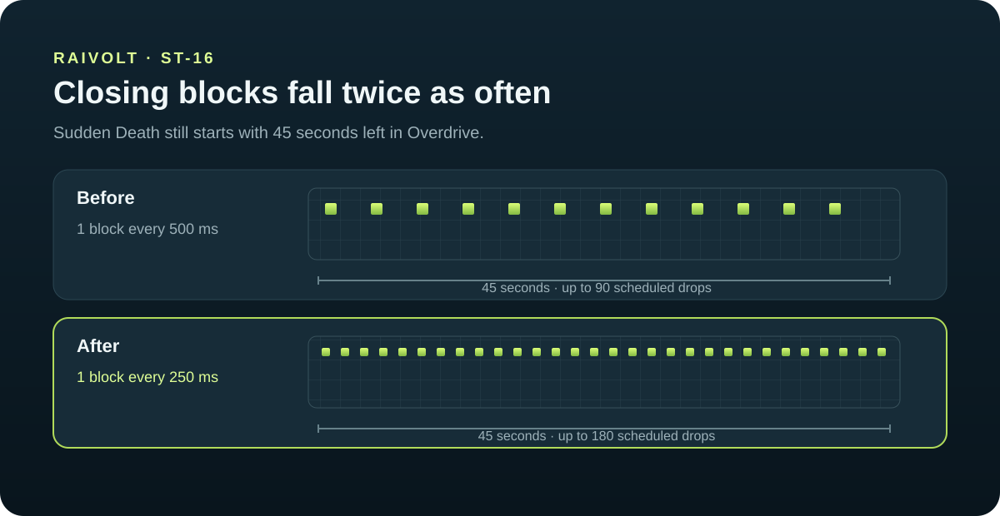

# ST-16 — Closing block speed

## Problema

No modo Raivolt Overdrive, os blocos da Sudden Death começavam a cair com 45 segundos restantes, mas o intervalo de 500 ms podia deixar uma parte da arena sem fechar quando o tempo acabava.

## Solução

O servidor agora agenda um bloco a cada 250 ms (4 por segundo), em vez de 500 ms (2 por segundo). O início da Sudden Death e o tempo de queda de cada bloco permanecem iguais. Em 45 segundos, a fila pode agendar até 180 blocos, o dobro de antes.

## Comparação visual

## Arquivo alterado

- `server/room.js` — intervalo entre blocos da Sudden Death.
