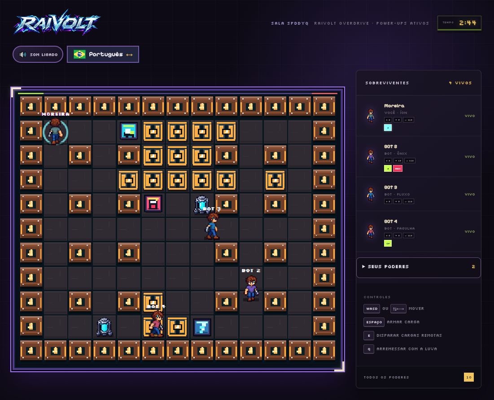
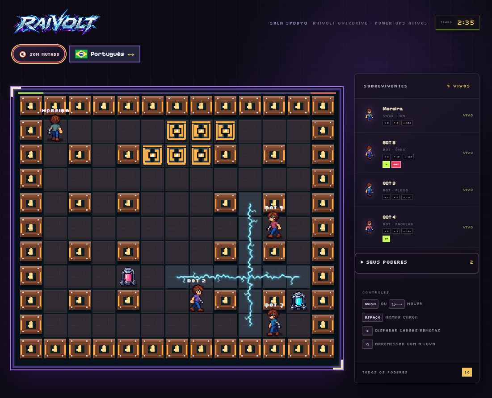

# ST-01 — Configurações de áudio com mute persistente

## Objetivo

Permitir que qualquer jogador mute ou reative todo o áudio do RAIVOLT com um único clique, mantendo a escolha ao navegar entre menu, lobby, partida e novos acessos.

## Comportamento validado

- controle visível no menu de opções em todas as telas;
- alternância imediata entre **Som ligado** e **Som mutado**;
- música de menu, música de batalha e todos os efeitos usam o mesmo estado central;
- preferência salva no `localStorage` e restaurada após recarregar a página;
- sincronização da preferência entre abas do mesmo navegador;
- rótulo acessível e estado `aria-pressed` atualizados junto com o ícone;
- funcionamento preservado quando o armazenamento do navegador está indisponível.

## Evidências

### Menu com preferência mutada restaurada


### Lobby mantendo a preferência


### Partida com áudio ligado



### Alteração para mute durante a partida



## Validação automatizada

```text
node --test
pnpm run build
```

Os testes cobrem persistência, armazenamento bloqueado, notificação dos consumidores, os 13 canais de áudio e a presença do controle no menu reutilizável.
