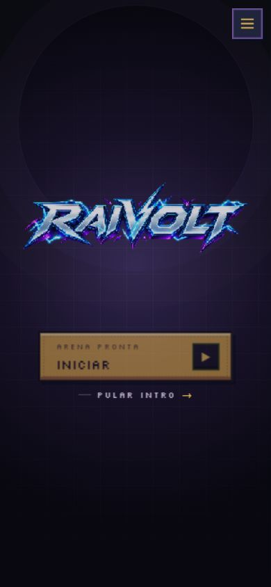
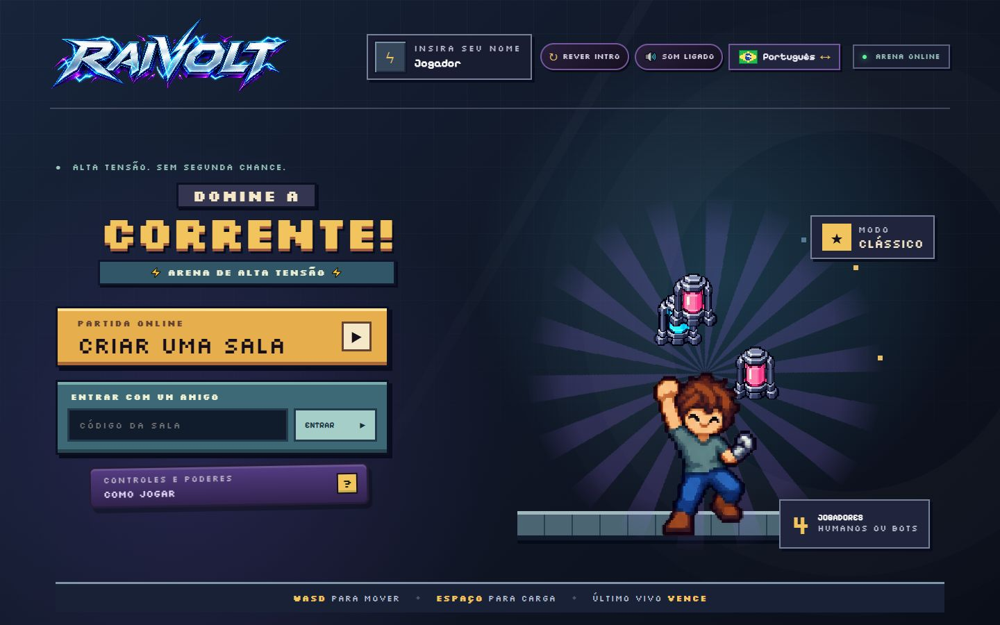
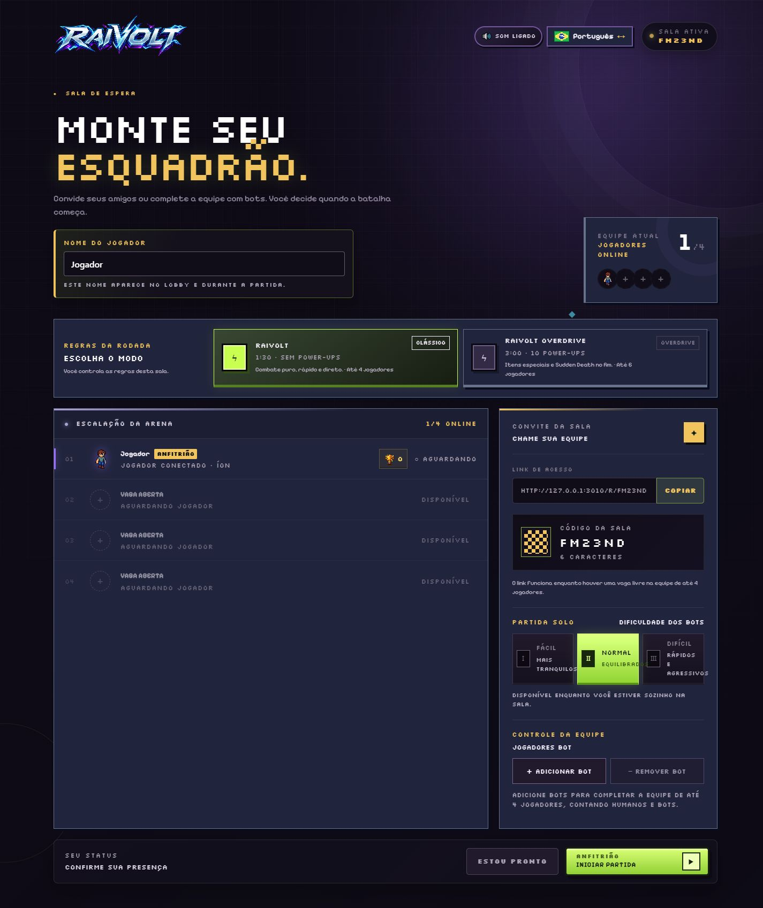
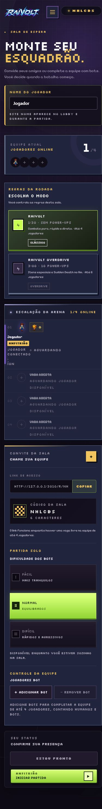
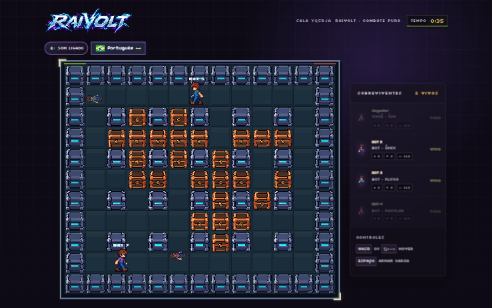
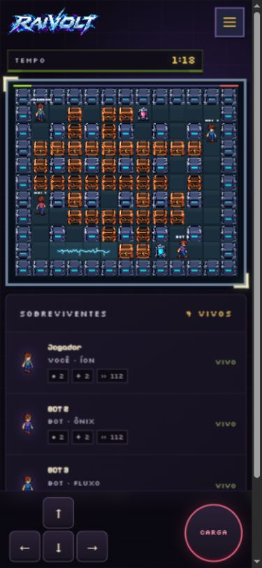

# ST-03 — Checklist visual de legibilidade e acessibilidade

## Escala acordada

- **12 px:** mínimo para labels, ações, regras, estados e textos essenciais.
- **11 px:** metadados auxiliares e textos compactos do HUD.
- **10 px:** somente números/ícones de atributos dentro do HUD, acompanhados por `title` acessível.
- Contraste reforçado com `--text-muted-readable` e `--text-subtle-readable` sobre os painéis escuros.

## Checklist por fluxo

- [x] Introdução: ação **Pular intro**, estado do carregamento e texto de apresentação legíveis.
- [x] Menu: nome do jogador, subtítulos dos botões, código da sala, guia e rodapé legíveis.
- [x] Lobby: regras, modo, slots, convite, dificuldade, controles de bots e ações legíveis.
- [x] Transições: kicker, status, contagem e dica inferior legíveis.
- [x] HUD: cronômetro, sobreviventes, nomes, estados, atributos, controles e botões touch legíveis.
- [x] Resultados: ranking, estados, troféus e ações cobertos pela mesma escala.
- [x] Foco por teclado visível com contorno de 3 px.
- [x] Sem rolagem horizontal em 390 × 844, 768 × 1024 e 1440 × 900.
- [x] Menu de preferências compactado abaixo de 980 px para impedir colisão no cabeçalho.

## Breakpoints validados

| Viewport | Menu/intro | Lobby | HUD | Overflow horizontal |
| --- | --- | --- | --- | --- |
| 390 × 844 | Aprovado | Aprovado | Aprovado | Não |
| 768 × 1024 | Aprovado | Aprovado | Aprovado | Não |
| 1440 × 900 | Aprovado | Aprovado | Aprovado | Não |

## Evidências

### Introdução — 390 × 844

### Menu — 1440 × 900

### Lobby — desktop e celular

### HUD — desktop e celular

## Validação técnica

- `node --test test/legibility.test.js`
- `pnpm run build`
- Inspeção de estilos computados via navegador: 12 px para textos essenciais; 10–11 px apenas nos metadados compactos definidos acima.
