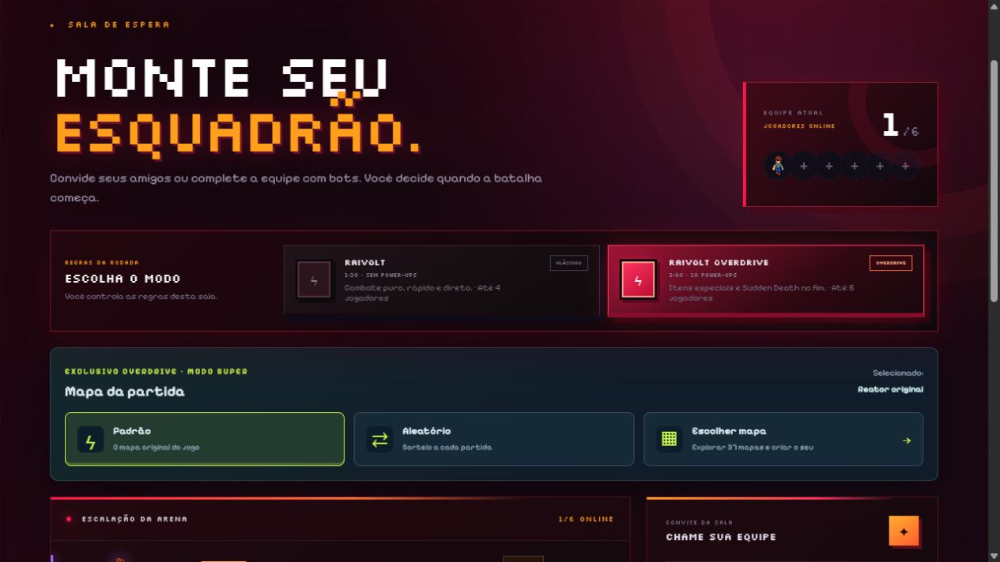
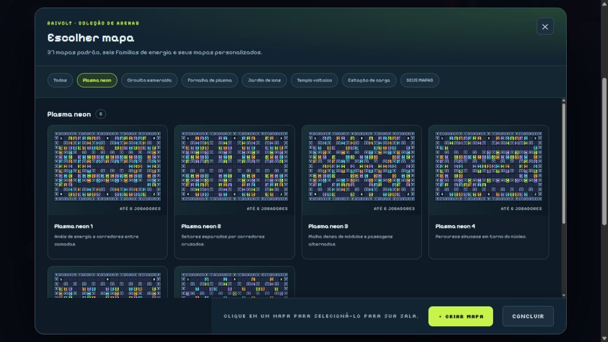
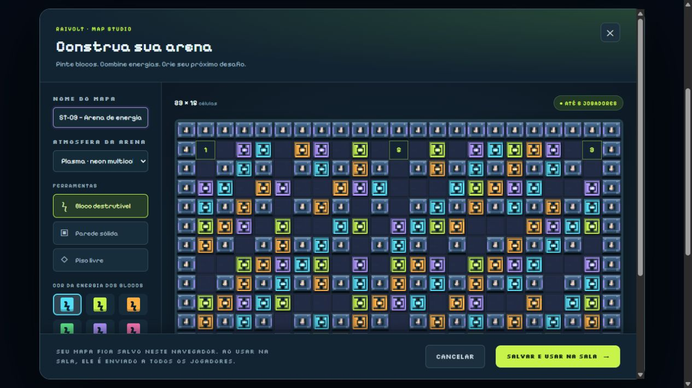
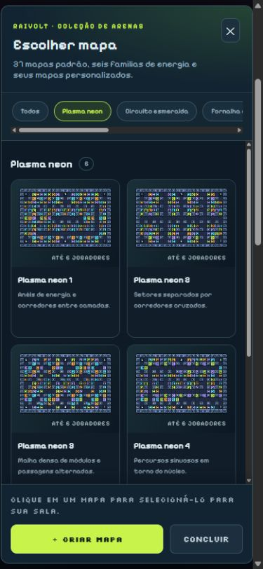

# ST-09 — Sistema de terrenos configuráveis

O anfitrião pode configurar o terreno da próxima partida no modo Super (RAIVOLT Overdrive). O lobby mantém três opções compactas — **Padrão**, **Aleatório** e **Escolher mapa** — e abre a coleção e o editor em janelas separadas.

## Atualizações entregues

- **Coleção de 37 mapas:** o mapa original e 36 arenas adaptadas das referências, divididas em seis famílias com seis variações: Plasma neon, Circuito esmeralda, Fornalha de plasma, Jardim de íons, Templo voltaico e Estação de carga.
- **Até seis jogadores:** os mapas padrão usam 13 × 11 células para até quatro participantes e 23 × 15 para cinco ou seis. As posições iniciais e as saídas são protegidas.
- **Seleção compacta:** a coleção saiu do lobby e passou para uma janela com previews, filtros por família e biblioteca pessoal. O botão Criar mapa fica dentro dessa janela.
- **Sorteio no servidor:** Aleatório escolhe um dos 37 mapas padrão ao iniciar cada rodada, inclusive nas revanches. Todos os jogadores recebem o mesmo terreno. O sorteio pode repetir um mapa; personalizados ficam fora do sorteio.
- **Map Studio:** edição visual com paredes, blocos destrutíveis, piso livre, seis cores de energia, sete atmosferas, 37 modelos e desfazer/refazer. A pintura funciona por clique, arraste e teclado.
- **Biblioteca pessoal:** permite salvar, editar e excluir até 12 mapas neste navegador. Salvar e usar na sala seleciona o personalizado e envia sua configuração a todos os participantes.
- **Validação no servidor:** somente o anfitrião pode mudar o mapa, apenas no lobby e no modo Super. Personalizados exigem nome válido, borda fechada, saídas livres e conexão entre todas as células jogáveis, considerando a destruição dos blocos.
- **Sincronização e renderização:** o mapa selecionado, o tema e as cores acompanham a partida e seus snapshots. A camada estática da arena usa cache para evitar redesenho integral a cada frame.
- **Desenvolvimento:** `npm run dev` usa `node --watch` para reiniciar o servidor quando seus módulos mudam, evitando que uma interface atualizada converse com uma instância antiga.

## Regras preservadas

O modo Clássico continua usando o mapa original. Mapas personalizados sempre têm 23 × 15 células e seis posições iniciais fixas. A biblioteca é local ao navegador; limpar seus dados remove os mapas salvos. Os convidados podem consultar a coleção, mas a configuração da sala pertence ao anfitrião.

## Validação

- **100 testes aprovados** com `node --test --test-reporter=dot`.
- **Build aprovado** com `npm run build`.
- Os testes verificam os 37 mapas, layouts distintos nas duas dimensões, partidas com quatro/cinco/seis participantes, seleção e início de cada uma das 36 arenas novas com seis jogadores, sorteio, permissões, validação, biblioteca e renderização/cache.
- Conferência no navegador: menu compacto, seis filtros com seis arenas cada, seleção de mapa, criação e salvamento a partir dos novos modelos e apresentação em tela de celular.

## Prints

### 1. Lobby com as três opções

### 2. Coleção em janela separada

### 3. Editor de terrenos

### 4. Seleção no celular

Para reproduzir: execute `npm run dev`, crie uma sala, selecione **Overdrive** e use **Escolher mapa**. A documentação de uso e da implementação está em [MAPAS.md](../../MAPAS.md).
