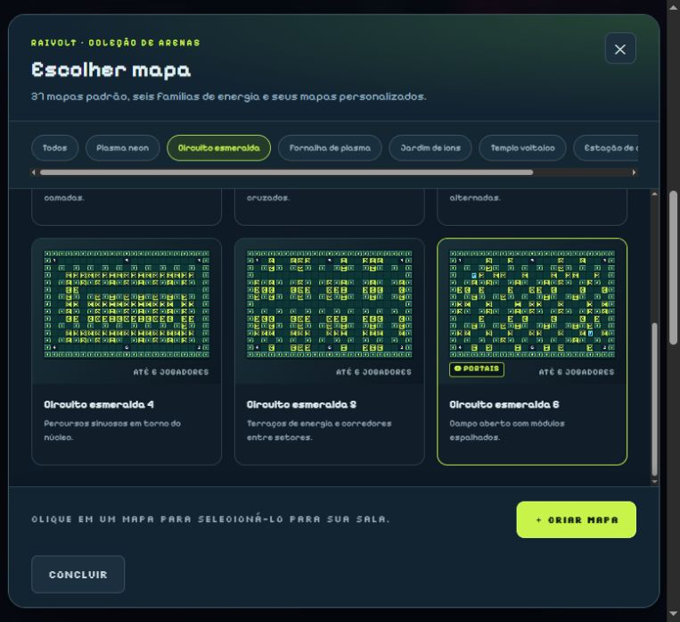
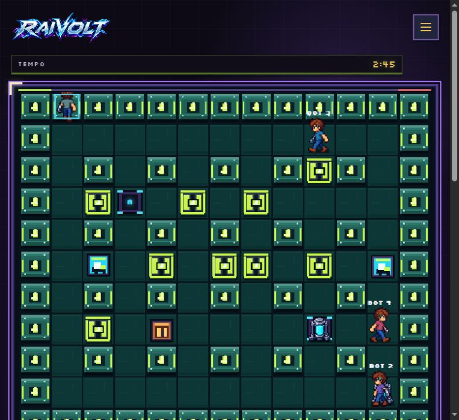

# Evidências visuais — ST-10

Validação executada em `http://localhost:3012`, com sala Overdrive e quatro
participantes (um jogador e três bots).

## 1. Terreno identificado no seletor

O filtro **Circuito esmeralda** exibe seis terrenos. Apenas o Circuito 6 recebe
o selo **PORTAIS**; a prévia mostra os dois pontos nas posições reais. O mesmo
critério foi conferido no DOM para Plasma 4 e Estação 5, enquanto os demais
cards permanecem sem o selo.

## 2. Par comunicado dentro da arena

O par aparece sobre piso livre nos quadrantes noroeste e sudeste. Os dois pontos
usam a mesma letra e cor, permitindo que o jogador antecipe o destino antes de
entrar no portal.

## Checklist visual

- [x] Selo visível apenas nos terrenos que declaram portais.
- [x] Prévia do mapa representa a posição dos endpoints.
- [x] Origem e destino usam a mesma letra e cor.
- [x] Portais mantêm contraste sobre o piso temático.
- [x] Personagens, caixas, HUD e portais continuam distinguíveis.
- [x] Tooltip traduzido não polui o nome acessível do card.
- [x] Fluxo real: menu → lobby → Overdrive → seleção → partida.
- [x] Movimento por teclado exercitado durante a partida.
- [x] Console do navegador sem erros ou avisos.

## Validação automatizada

Os 38 testes diretamente relacionados a mapas, portais, reconciliação e
renderização passaram. O build Vite de produção também foi concluído.

A suíte global mantém quatro falhas preexistentes no branch principal: uma
expectativa de marcação da legenda de poderes, duas expectativas antigas de
movimento e um seed de sobrevivência do bot. Nesta cópia de trabalho, elas
aparecem duplicadas porque existe uma segunda árvore de testes não rastreada
dentro de `server/`; nenhum arquivo dessa árvore foi incluído na ST-10.
