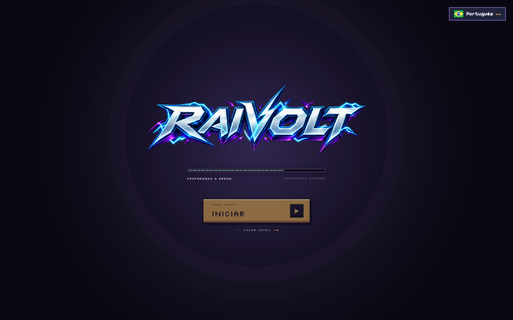
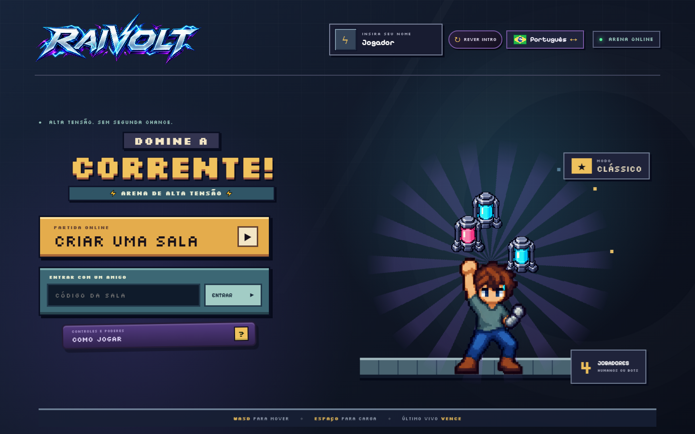
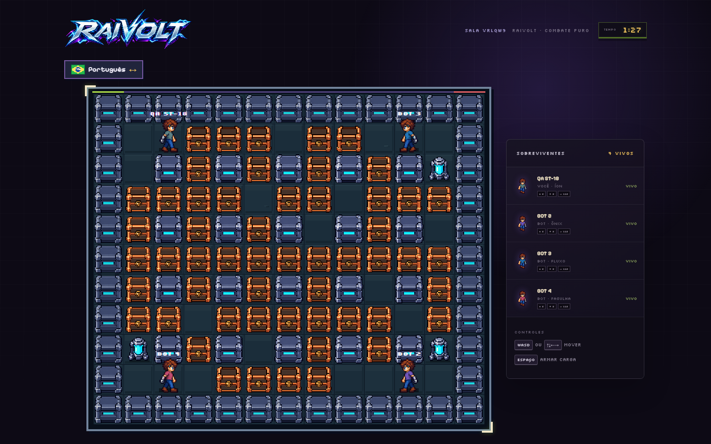

# ST-18 — Pular introdução, personagens e métodos anti-lag

Esta entrega reúne três melhorias que afetam diretamente o primeiro contato e a
sensação de controle do **Raivolt**: liberdade para ignorar ou rever a
apresentação, bloqueio completo do personagem eliminado e uma revisão do caminho
crítico de renderização/predição para reduzir engasgos durante a partida.

## Resultado

| Área | Antes | Agora |
| --- | --- | --- |
| Introdução | Era necessário aguardar toda a sequência | `Pular intro` fica disponível desde o primeiro quadro |
| Retorno ao jogo | Não havia uma forma clara de rever a abertura | O menu oferece `Rever intro` sem recarregar a página |
| Personagem eliminado | A predição local ainda podia deslocar visualmente o personagem morto | Entrada, som de passos, alvo de movimento e controles são interrompidos ao receber a eliminação |
| Movimentação | O render podia alternar entre 60 e 30 FPS e criar estruturas a cada quadro | Todo `requestAnimationFrame` útil é renderizado e estruturas quentes são reutilizadas |
| Início da partida | Scroll herdado do lobby e painel lateral aberto deslocavam a arena | A partida volta ao topo e a legenda começa recolhida |

## 1. Introdução sob controle do jogador

O novo atalho aparece abaixo de **Iniciar**, como nos menus de jogos de console.
Ele é discreto o suficiente para preservar a apresentação, mas permanece visível
e acessível por teclado durante toda a sequência. Ao acioná-lo, os timers são
cancelados, a camada da abertura é removida imediatamente e o foco segue para a
ação principal do menu.

Depois da primeira exibição na página, a abertura não interrompe novamente a
navegação. Quem quiser assisti-la pode usar **Rever intro** no cabeçalho. Textos e
rótulos acessíveis existem em português e inglês.

## 2. Personagem eliminado não recebe movimento

A correção atua em duas camadas:

- a predição e a reconciliação retornam imediatamente para jogadores com
  `alive === false`, removendo qualquer `moveTarget` residual;
- ao chegar o snapshot autoritativo de eliminação, o cliente encerra listeners,
  heartbeat de entrada, som de passos e botões touch.

Isso mantém servidor e cliente com a mesma regra: personagem eliminado permanece
na posição confirmada e não responde a teclas que já estavam pressionadas.

## 3. Caminho de renderização mais estável

As otimizações foram concentradas no que roda a cada quadro:

- remoção do limitador manual que podia desperdiçar um refresh e produzir a
  sensação de alternância entre 60 e 30 FPS;
- cache do `canvas` e reaproveitamento de `Map`/`Set` usados na apresentação;
- atualização do HUD apenas quando tempo, poderes ou estado realmente mudam;
- desenho das descargas com menos camadas e ruído determinístico mais barato;
- correção gradual da predição, com avanço limitado e recuperação sem teleporte;
- descarte de snapshots antigos quando o WebSocket está congestionado;
- reinício do scroll no começo da partida e painel de poderes inicialmente
  recolhido, evitando que a página desça sozinha.

Em desenvolvimento, `window.__raivoltRenderStats` e o atributo
`data-render-stats` do `#app` expõem contagem de quadros, FPS, intervalo médio,
maior intervalo e quadros acima de 25 ms sem desenhar telemetria sobre a arena.

## Validação

- `node --test`: **92 testes aprovados**.
- `pnpm build`: build Vite concluído sem erros.
- Testes dedicados cobrem pulo imediato, persistência tolerante a falhas,
  replay da intro, jogador eliminado, snapshots atrasados, correção progressiva,
  jitter semelhante ao de renderização, virada rápida e limites de predição.
- Fluxo real conferido no navegador em 1440 × 900: intro, menu, criação de sala,
  lobby, contagem regressiva, movimentação e colocação de carga.

## Como testar manualmente

1. Rode `pnpm dev` e abra `http://localhost:3000` em uma janela anônima.
2. Confirme que **Pular intro** aparece antes de o botão **Iniciar** ser liberado.
3. Clique no atalho e verifique a entrada imediata no menu, sem salto de scroll.
4. Use **Rever intro**, assista à sequência e confira a saída normal.
5. Crie uma sala, marque-se como pronto e inicie uma partida.
6. Mantenha uma direção pressionada durante snapshots com atraso e observe a
   continuidade do movimento, sem recuos ou microparadas.
7. Após ser eliminado, mantenha uma tecla pressionada e confirme que o personagem
   e os controles permanecem inativos.

## Arquivos principais

| Arquivo | Responsabilidade nesta entrega |
| --- | --- |
| `client/components/menu-intro.js` | Fluxo, timers, skip e preferência da introdução |
| `client/settings-menu.js` | Ação global para rever a abertura |
| `client/main.js` | Ciclo de telas, render loop, HUD, scroll e bloqueio pós-morte |
| `client/netcode.js` | Predição e reconciliação do jogador local |
| `client/render.js` | Reutilização de estruturas e custo visual das descargas |
| `test/menu-intro.test.js` | Cobertura do fluxo de apresentação |
| `test/netcode.test.js` | Regressões de movimento, jitter e jogador eliminado |
